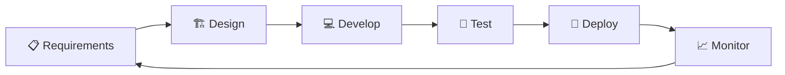

<div align="center">

<!-- ===================== HERO ===================== -->


<br>

<a href="https://github.com/supriyasinghdev">

</a>

<br>

<a href="https://github.com/supriyasinghdev">

</a>
<a href="https://github.com/supriyasinghdev?tab=followers">

</a>
<a href="https://github.com/supriyasinghdev?tab=repositories">

</a>

</div>

---

# 👩‍💻 About Me

<table>
<tr>

<td width="62%" valign="top">

### 🚀 Who I Am

I'm a **Software Engineering enthusiast** who loves turning real-world problems into well-structured, reliable software.

* 🎯 Goal: grow into a strong **Software Engineer**
* 🏗️ Learning **System Design** & software architecture
* 🧩 Practicing **Data Structures & Algorithms**
* 🔁 Following the full **SDLC** — requirements → design → code → test → deploy
* 🧪 Writing **testable, clean and documented** code
* ⚙️ Exploring **Git workflows, CI/CD & DevOps basics**
* 🤝 Open to **open-source, team projects & collaboration**

</td>

<td width="38%" align="center">


<br><br>


<br><br>


<br><br>


</td>

</tr>
</table>

---

# 🖥️ `whoami`

```python
class SoftwareEngineer:
    def __init__(self):
        self.name = "Supriya Singh"
        self.role = "Software Engineer (in progress)"
        self.focus = ["Clean Code", "System Design", "DSA", "Testing", "CI/CD"]
        self.principles = ["SOLID", "DRY", "KISS", "YAGNI"]
        self.currently_learning = ["Design Patterns", "Scalable Architecture", "DevOps"]
        self.motto = "Make it work, make it right, make it fast."

    def daily_routine(self):
        while True:
            self.learn()
            self.code()
            self.test()
            self.commit()
            self.improve()
```

---

# 🔁 How I Build Software



---

# 🛠️ Tech Stack

<div align="center">

### 💻 Programming Languages


### 🌐 Frameworks & Backend


### 🗄️ Databases


### ⚙️ DevOps, Cloud & Tools


</div>

---

# 🧠 Software Engineering Skills

<div align="center">

<table width="100%">
<tr>
<td width="33%" valign="top" align="center">

### 🏗️ Design
<code>System Design</code><br>
<code>OOP</code><br>
<code>Design Patterns</code><br>
<code>UML Diagrams</code><br>
<code>REST API Design</code>

</td>
<td width="33%" valign="top" align="center">

### 🧪 Quality
<code>Unit Testing</code><br>
<code>TDD</code><br>
<code>Code Reviews</code><br>
<code>Refactoring</code><br>
<code>Documentation</code>

</td>
<td width="33%" valign="top" align="center">

### ⚙️ Delivery
<code>Git Workflow</code><br>
<code>CI/CD</code><br>
<code>Docker</code><br>
<code>Agile / Scrum</code><br>
<code>Version Control</code>

</td>
</tr>
</table>

</div>

---

# 📊 GitHub Analytics

<div align="center">

<table width="100%">
<tr>

<td width="50%" align="center">


</td>

<td width="50%" align="center">


</td>

</tr>
</table>

</div>

---

# 📈 Contribution Activity

<div align="center">


</div>

---

# 💻 Languages & Productivity

<div align="center">

<table width="100%">
<tr>

<td width="33%" align="center">

</td>

<td width="33%" align="center">

</td>

<td width="33%" align="center">

</td>

</tr>
</table>

</div>

---

# 🏆 GitHub Achievements

<div align="center">


</div>

---

# 🚀 Featured Projects

<!--
✏️ EDIT THIS SECTION:
Replace PROJECT NAME, description, tech and REPO_NAME with your real projects.
-->

<div align="center">

<table width="100%">
<tr>

<!-- ================= PROJECT 1 ================= -->

<td width="50%" valign="top" align="center">

<h3>🧩 PROJECT NAME 1</h3>

<p>
  
  
</p>

<p>
A scalable <b>backend service</b> built with clean architecture,
layered design and unit-tested endpoints.
</p>

<p><b>🛠️ Technologies</b></p>

<p>
  <code>Python</code>
  <code>FastAPI</code>
  <code>PostgreSQL</code>
  <code>Docker</code>
</p>

<a href="https://github.com/supriyasinghdev/REPO_NAME">
  
</a>

</td>

<!-- ================= PROJECT 2 ================= -->

<td width="50%" valign="top" align="center">

<h3>🌐 PROJECT NAME 2</h3>

<p>
  
  
</p>

<p>
A full-stack <b>web application</b> with authentication,
CRUD operations and CI/CD pipeline.
</p>

<p><b>🛠️ Technologies</b></p>

<p>
  <code>React</code>
  <code>Node.js</code>
  <code>MongoDB</code>
  <code>GitHub Actions</code>
</p>

<a href="https://YOUR-LIVE-DEMO-LINK">
  
</a>
<a href="https://github.com/supriyasinghdev/REPO_NAME">
  
</a>

</td>

</tr>
</table>

</div>

---

# 🎯 Engineering Principles I Follow

<div align="center">

| 🧱 Principle | 💡 Meaning |
|:---:|:---|
| **SOLID** | Write flexible and maintainable object-oriented code |
| **DRY** | Don't Repeat Yourself |
| **KISS** | Keep It Simple, Stupid |
| **YAGNI** | You Aren't Gonna Need It |
| **TDD** | Test first, code second |
| **CI/CD** | Automate build, test and deployment |

</div>

---

# 📚 Currently Exploring

<div align="center">


<br><br>


</div>

---

# 📊 Coding Profiles

<!-- ✏️ EDIT: replace YOUR_USERNAME with your real usernames, delete the ones you don't use -->

<div align="center">

<a href="https://leetcode.com/YOUR_USERNAME">

</a>
<a href="https://www.hackerrank.com/YOUR_USERNAME">

</a>
<a href="https://www.codechef.com/users/YOUR_USERNAME">

</a>
<a href="https://auth.geeksforgeeks.org/user/YOUR_USERNAME">

</a>

</div>

---

# 🤝 Connect With Me

<div align="center">

<a href="https://github.com/supriyasinghdev">

</a>
<a href="https://linkedin.com/in/YOUR_USERNAME">

</a>
<a href="https://www.instagram.com/YOUR_USERNAME">

</a>
<a href="mailto:YOUR_EMAIL@gmail.com">

</a>

</div>

---

<div align="center">

### 💻 Code • 🏗️ Design • 🧪 Test • 🚀 Ship • 🔁 Improve

**Thanks for visiting my GitHub profile!** 💜

<br>


</div>
